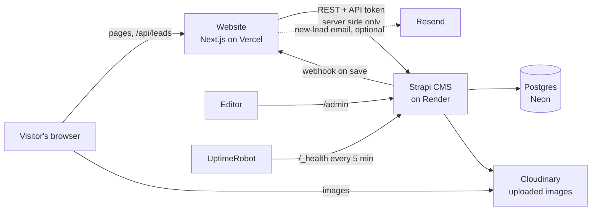
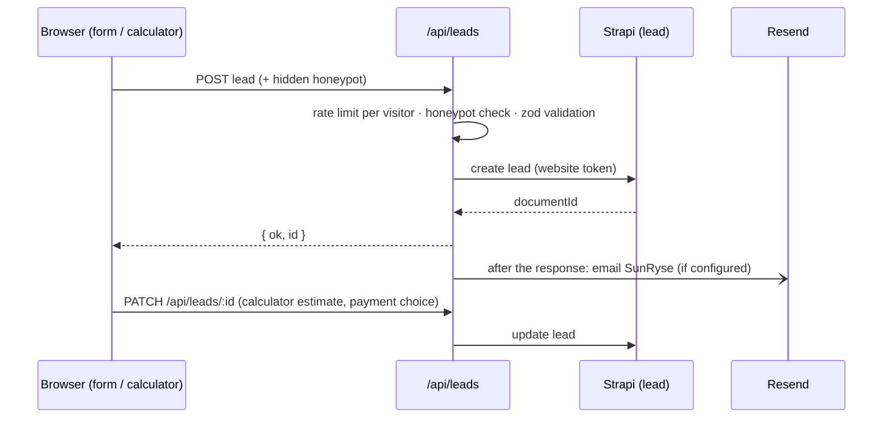

# SunRyse website: architecture

How the system is put together: the parts, how content and leads flow, and the rules that keep it working when
something is down. For what changed and when, see [CHANGES.md](CHANGES.md); for hosting steps, [DEPLOY-PLAN.md](DEPLOY-PLAN.md).

## 1. Overview

A **pnpm monorepo** with two apps:

| App | Stack | Role |
|---|---|---|
| `apps/web` | Next.js 16 (App Router, Cache Components), React 19, Tailwind CSS v4, shadcn/Radix UI, GSAP + Lenis + Motion, Three.js / React Three Fiber | The public website: pages, calculator, lead forms. Reads content from the CMS on the server only. |
| `apps/cms` | Strapi 5 (TypeScript), Postgres in production / SQLite locally, Cloudinary uploads | Content editing (admin) and the content API. Stores leads. |

`packages/` exists for shared code but is empty today; shared types live in `apps/web/lib/content/types.ts`.



Production (free setup, Nov 2026): website on **Vercel** (`sunryse.vercel.app`), CMS on **Render**
(`sunryse-cms.onrender.com`), database on **Neon**, images on **Cloudinary**, all in or near **Singapore**.

## 2. Repository layout

```
apps/
  web/
    app/                    routes (App Router)
      (site)/               public pages, shared layout (header, footer, sticky actions)
      api/leads/            create lead (POST) and update it from the calculator (PATCH /[id])
      api/revalidate/       CMS webhook target: refreshes cached content
      sitemap.ts, robots.ts
    components/
      site/                 header, footer, sticky mobile actions, logo, JSON-LD
      sections/home/        homepage sections (configurator hero, services deck, calculator teaser…)
      pages/                page-specific views (about, calculator wizard, contact form, service, solution…)
      pricing/              package / add-on / payment cards, sections, eligibility panel
      story/                homepage scroll story (camera stations, 3D scene, scroll + text)
      three-d/              shared 3D models and scenes (roofs, solution models)
      motion/               Lenis smooth scroll, reveal, scramble label
      fx/                   design primitives (Section, SectionHeader, Eyebrow, RichText, Hud…)
      forms/, ui/           honeypot field; shadcn components
    content/                bundled default content (JSON), the fallback for every CMS read
    lib/
      strapi.ts             cached CMS fetch, media URLs, lead create/update calls
      content/              loaders: from-strapi.ts (collections), pages/*.ts (page copy), index.ts (getters)
      solar-calc.ts         calculator engine (pure)
      financing.ts          monthly payment math (pure)
      pricing.ts            package helpers: grouping, teaser picking, closest package
      lead-schema.ts        zod validation shared by forms and API
      lead-guard.ts         honeypot + rate limit
      lead-notify.ts        new-lead email (Resend)
  cms/
    src/api/                content types (one folder each)
    src/components/         Strapi components: shared, sections (homepage), about, pricing
    src/index.ts            bootstrap: public read permissions, revalidate webhook
    config/                 server, database, plugins (upload provider), middlewares (CSP)
    scripts/                seed.ts, setup-web.ts, patch-content.ts (+ patches/)
docs/                       plans, records, designs, content checklist
```

## 3. Content model (Strapi)

**Single types** (one entry each)

| Type | Holds | Stored as |
|---|---|---|
| `global` | site name, contact details, address, hours, socials, nav, footer, interface labels (`ui`) | fields + components |
| `homepage` | homepage sections in a dynamic zone | components (`sections.*`) |
| `about-page` | About page | real fields + `about.*` components |
| `pricing-page` | /pricing copy and the homepage pricing sections | real fields + `pricing.*` components |
| `calculator-config` | calculator rates, price book, presets | fields |
| `story-page`, `calculator-page`, `contact-page`, `projects-page`, `service-defaults` | page copy | one `content` JSON field |

**Collections** (many entries, sorted by `order`)

`service`, `solution`, `project`, `testimonial`, `faq`, `brand` (with logo), `impact-stat`, `warranty`,
`team-member` (with photo), `solar-package`, `add-on`, `payment-option`, `article`, and `lead` (never public).

Two content styles exist side by side: newer pages (About, Pricing) use **real fields**, which are easier for editors;
older page copy uses a **JSON field**. Both are merged over the bundled JSON the same way (section 4).

## 4. Reading content

```mermaid
sequenceDiagram
  participant P as Page (server)
  participant L as Loader (lib/content)
  participant F as strapiFetch ("use cache")
  participant S as Strapi
  P->>L: getPackages() / getPricingPage() …
  L->>F: path, query, cache tags
  F->>S: GET /api/... (Bearer token)
  S-->>F: JSON
  F-->>L: cached result (hours; ~1 min if it failed)
  L-->>P: mapped data merged over bundled JSON
```

- **Server only.** `lib/strapi.ts` is `server-only`; the API token never reaches the browser.
- **Cache Components.** `strapiFetch` is a `"use cache"` function tagged `strapi` (plus a type tag). Good reads are
  cached for hours; failed reads for about a minute ("minutes" profile). Shorter caches count as live data in Next,
  which would stop pages from being pre-rendered.
- **Always a fallback.** Every getter falls back to `apps/web/content/*.json`:
  - `withFallback` (collections): no `STRAPI_URL`, an error, or an empty list → bundled JSON.
  - `mergeContent` (page copy): merges CMS values over the defaults key by key. Unknown keys are dropped, wrong types
    ignored, blank text keeps the default, and list items are filled from the matching default item.
  - Result: a half-edited entry, a missing field or a CMS outage never breaks a page, and the site builds with no CMS.
- **Mapping.** `from-strapi.ts` and `lib/content/pages/*.ts` turn Strapi's shape into the site's types: enum values
  (`grid_tie` → `grid-tie`), decimals to numbers, media to absolute URLs, computed values (package kWp).
- **Refresh after edits.** Saving in the admin fires the "Website revalidate" webhook → `POST /api/revalidate` with the
  shared secret → `revalidateTag("strapi")`. Pages update within seconds. The CMS creates or updates this webhook on
  every start from `WEB_REVALIDATE_URL` and `WEB_REVALIDATE_SECRET`.
- **Media.** Strapi returns upload URLs. Locally they are `/uploads/...` on the CMS; in production, Cloudinary URLs.
  `next/image` only optimises images from the CMS host and the configured Cloudinary account (`next.config.ts`).

## 5. Rendering and pages

| Route | Notes |
|---|---|
| `/` | Scroll story (client, 3D, lazy loaded) → configurator hero → CMS-driven sections → pricing sections |
| `/pricing` | Packages grouped by system type, add-ons, payment options with the eligibility panel |
| `/solutions/[slug]`, `/services/[slug]` | Static params from content; catalogue packages per segment on solution pages |
| `/calculator` | Client wizard on top of `lib/solar-calc.ts`; contact step first, proposal last |
| `/contact` | 3-step quote form; query string pre-fills it (calculator and pricing links); Google map of the office |
| `/about`, `/projects`, `/services`, `/privacy`, `/terms` | Content pages (privacy / terms copy is bundled JSON) |
| `/api/leads`, `/api/leads/[id]`, `/api/revalidate` | Dynamic route handlers |

- Pages are **pre-rendered** and refreshed by tag (Cache Components with partial prefetching). Pages that depend on the
  URL query read it on the client inside `<Suspense>` so the page itself stays static.
- **Client islands** only where needed: the story and the configurator's WebGL scene (loaded with `next/dynamic`, no SSR),
  the calculator wizard, forms, the eligibility panel and motion.
- **Motion system:** Lenis smooth scrolling synced to GSAP ScrollTrigger; SplitText / ScrambleText reveals.
  `prefers-reduced-motion` turns off smooth scrolling, scrub animations and CSS transitions (global rule in `globals.css`).
- **Design system:** tokens and utilities in `app/globals.css` (Tailwind v4 `@theme`); rules in the `sunryse-design` skill.

## 6. Calculator and pricing logic

All pure TypeScript with unit tests; no React inside.

- **`solar-calc.ts`:** bill → usage → an hour-by-hour day model (solar curve, usage periods, battery) → monthly
  savings, all-in price (`systemPrice()`), payback, lifetime savings, ₱/kWh, CO₂. `planPackages()` sizes three options.
  Settings come from `calculator-config`, falling back to `DEFAULT_CONFIG`.
- **`financing.ts`:** amortised monthly payment, down payment, term choices.
- **`pricing.ts`:** groups packages by type, picks the homepage row around the **featured** package, and finds the
  **closest standard package** for a calculator result (same type, same battery-or-not, nearest kWp).
- **Consistency check:** a test keeps each bundled package price within 15 % of `systemPrice()` for the same system.

## 7. Leads



- **One schema** (`lead-schema.ts`, zod) validates on the client and the server. Unknown fields are dropped.
- **Spam:** a hidden honeypot field (bots get "ok", nothing is saved) and per-visitor limits (5 new / 10 min,
  40 updates / 10 min). Limits are per server instance; use a Vercel firewall rule for a hard limit.
- **Never public:** leads can't be listed through the API; the website token can only create and update.
- **Fields:** contact details, segment, bill, roof, stage (`calculator-started` → `estimate-ready` / `quote-request`),
  source (`contact-form`, `calculator`, `pricing`), package, add-ons, preferred payment, and the calculator snapshot (JSON).

## 8. Security

- **Secrets** live only in git-ignored env files (`.env`, `.env.local`, `.env.render`, `.env.vercel`) and in the hosts'
  settings; templates without values are in `.env.example`.
- **API tokens:** "website" (read content, create/update leads) for production; optional read-only "website-preview"
  for preview builds. `PRINT_PERMISSIONS=1 pnpm --filter cms setup:web` lists them.
- **Public role** can read content types (granted on CMS start) but never leads.
- **Webhook:** `/api/revalidate` requires the shared `x-revalidate-secret` header.
- **CMS:** admin CSP allows Cloudinary images only; uploads exclude SVG and executables; Postgres over verified SSL.
- **Website images:** only from the CMS host and the configured Cloudinary account.

## 9. Environments

| | Local | Production (free setup) |
|---|---|---|
| Website | `pnpm dev` → localhost:3000 | Vercel, Root Directory `apps/web`, functions in Singapore |
| CMS | localhost:1337 | Render web service, `cd apps/cms && npm run start` |
| Database | SQLite `apps/cms/.tmp/data.db` | Neon Postgres (`DATABASE_URL`, SSL) |
| Media | `apps/cms/public/uploads` | Cloudinary (`CLOUDINARY_*`) |
| Env files | `apps/web/.env.local`, `apps/cms/.env` (written by `pnpm setup`) | host settings (from `.env.vercel`, `.env.render`) |

**Deploys:** pushing to `main` builds the website on Vercel and the CMS on Render. Schema changes: deploy the CMS
first, then the website, and add new types to the API token. Content edits need no deploy.

**Moving content:** `strapi transfer` copies content, media and settings between Strapi instances (it replaces the
destination's data). `pnpm --filter cms seed` fills an empty CMS from the bundled JSON instead.

## 10. Failure behaviour

| What fails | What visitors see |
|---|---|
| CMS unreachable during a build | Build succeeds from bundled content; pages refresh about a minute after the CMS answers |
| CMS down or asleep at runtime | Cached pages keep serving; a failed refresh shows bundled text until the next successful read |
| A CMS field is blank or malformed | That field falls back to the bundled default |
| Lead save fails | Contact form shows an error with a call option; the calculator continues and retries with the estimate |
| Email (Resend) fails | Logged only; the lead is already saved |
| No WebGL2, data saver or a weak device | Story: static chapter version. Configurator: stays on its non-WebGL scene (the WebGL upgrade is desktop ≥ 1024 px, WebGL2, ≥ 4 GB memory, no data saver) |
| Phone / reduced motion | Story: lighter 3D scene on phones; reduced motion jumps between chapters and stops autoplay and smooth scrolling |

## 11. Testing

`pnpm --filter web test` (Vitest, 63 tests): calculator engine and calibration, financing, pricing helpers and the
package price check, CMS fallbacks with a mocked Strapi, pricing empty states (server-rendered), lead guard and email,
story camera timing, configurator model. Lint (`eslint`) and `tsc` run on the web app; `tsc` on the CMS.
`STRAPI_URL=http://127.0.0.1:9 pnpm --filter web build` checks the build without a CMS.
